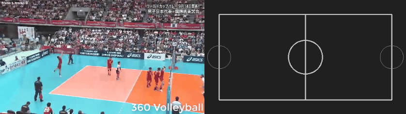
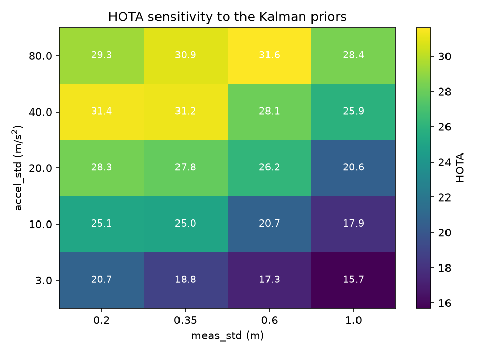

# GroundTrack — multi-object tracking on the metric ground plane

A from-scratch multi-object tracker whose Kalman filter runs in **metres on the ground
plane** instead of pixels, evaluated against image-space baselines on **SportsMOT val**
with TrackEval (HOTA / CLEAR / Identity).

The Kalman filter, the normalised-DLT homography, the Mahalanobis gating, the
ByteTrack-style two-stage association, the track lifecycle, the colour gate and the
camera-motion compensation are all implemented here. The detector is off-the-shelf and
frozen; `scipy` provides the Hungarian solver; TrackEval provides the metrics.



*Left: tracked players in the image. Right: the same players on the court in metres, with per-player speed. Both panels come from one run.*

## The idea

Tracking in pixel space forces you to tune process noise in units that mean nothing:
"how many pixels per frame squared does a person accelerate?" depends on where in the
frame they are standing. Project the player's **foot point** onto the ground plane first
and the same question becomes physical — a sprinting human changes velocity by about
**3 m/s²** — so `accel_std: 3.0` is a measurement rather than a knob.

```
         detection box                     ┌──────────────── world (metres) ───────────────┐
             │                             │                                               │
      foot point = bottom-centre  ──► H_t ─┤  Kalman filter: [x, y, vx, vy] in m and m/s   │
      (the only point on the plane)        │  process noise = acceleration in m/s²         │
                                           └───────────────────────────────────────────────┘
                     H_t = H_ref @ W(t→ref)
                            │        └── ORB+RANSAC camera-motion compensation
                            └─────────── homography from 4+ typed court landmarks
```

### Why the box centre is the wrong point

A homography is only valid for points **on** the plane it was fitted to. The box centre
floats about a metre above the floor, so its projection shifts with the player's height
and the camera angle; the bottom-centre is the one point that actually touches the
ground.

### Why camera motion never reaches the filter

SportsMOT cameras pan and zoom, so a homography clicked on one frame is stale by the
next. Composing it with the CMC warp, `H_t = H_ref @ W(t→ref)`, means **camera motion is
absorbed into the projection** and the filter only ever sees real player motion. That is
the difference between T4 and T6 in the table below, and T6 is in the repo precisely to
show that metres alone are not magic.

CMC matches ORB features **directly against the reference frame** rather than chaining
frame-to-frame (which drifts over ~750 frames), falling back to chaining only when a
direct match is too weak. Player pixels are masked out before feature detection —
matching on moving players is the exact failure mode CMC is supposed to avoid.

## One transform, four ablation rows

Every row is the same code with a different measurement transform, which is what makes
the comparison fair:

| configuration | `M_t` | filter state lives in |
|---|---|---|
| image, no CMC | `I` | pixels, current frame |
| image, CMC | `W(t→ref)` | pixels, reference frame |
| ground, no CMC | `H_ref` | metres, stale calibration |
| ground, CMC | `H_ref @ W(t→ref)` | metres, correct |

## Association

ByteTrack-shaped, two passes:

1. **high-confidence** detections (≥ 0.50) associate against all active tracks;
2. the leftover **low-confidence** detections (0.10–0.50) get a second pass against
   still-unmatched tracks — this is what recovers a partially occluded player the
   detector scored at 0.2, instead of losing the ID and re-creating it three frames later.

Gates, each switchable so the ablation can isolate it:

- **chi-square gate** — squared Mahalanobis distance under the *projected* covariance
  (position + sensor noise), compared against 9.21 for 2 dof at p=0.99. Using the
  projected covariance is what makes the gate correct for a newborn track whose velocity
  is still unknown.
- **colour gate** — Bhattacharyya distance between HSV torso histograms (middle 50% of
  the box width, 20–60% of its height: head and legs are mostly background and grass).
- **speed gate** — reject displacements implying more than `max_speed_mps: 11.0`. Only
  meaningful in ground space, where the number has units.

Hungarian assignment is `scipy.optimize.linear_sum_assignment`, with the gate applied
**after** solving so it cannot distort the global optimum. `tests/test_assignment.py`
checks it against brute force on small problems.

## Results

SportsMOT val, three volleyball sequences (1 473 frames, 2 calibrated courts + 1), a frozen
COCO-pretrained YOLO detector, TrackEval HOTA/CLEAR/Identity. Higher is better except IDSW.

| row | change | HOTA | DetA | AssA | MOTA | IDF1 | IDSW | Frag | fps |
|---|---|---|---|---|---|---|---|---|---|
| T0 | image / IoU / 1-stage (SORT-like) | 26.2 | 43.88 | 15.72 | 22.45 | 21.54 | 655 | 858 | - |
| T1 | + CMC | 26.86 | 43.69 | 16.59 | 22.94 | 23.14 | 716 | 1035 | - |
| T2 | + two-stage association | 28.26 | 44.54 | 18.05 | 16.97 | 23.73 | 876 | 940 | - |
| T3 | Mahalanobis cost (still image space) | 27.81 | 37.3 | 20.81 | -21.83 | 25.53 | 1382 | 788 | - |
| T4 | ground plane, H_t = H_ref @ W(t->ref) | 23.86 | 36.68 | 15.65 | -28.31 | 19.11 | 2394 | 925 | - |
| T5 | + jersey-colour gate | 26.76 | 39.95 | 18.05 | -12.46 | 22.36 | 2474 | 907 | - |
| T7 | ground plane + CMC, cost held at IoU (isolates the space) | 27.78 | 43.33 | 17.95 | 13.26 | 23.6 | 1075 | 1129 | - |
| T8 | ground + CMC + per-detection R = J Rpx J^T | 21.48 | 38.44 | 12.14 | -20.32 | 16.0 | 2734 | 1107 | - |
| T6 | ground plane, STATIC H_ref, no CMC | 31.24 | 39.89 | 24.67 | -11.48 | 27.22 | 1620 | 656 | - |
| T9 | ground + ADAPTIVE CMC (apply the warp only when the camera moved) | 28.07 | 39.72 | 19.99 | -11.65 | 23.79 | 2059 | 879 | - |

All rows share one frozen detection cache (yolo26n, COCO weights, conf 0.10) so differences are tracking, not detection. Both coordinate spaces were tuned the same way: an accel_std x meas_std sweep on clip A, best taken (image 250 px/s^2 / 20 px; ground 40 m/s^2 / 0.35 m). Read the per-sequence CSVs - the combined column hides the CMC effect almost perfectly.

### Per-sequence HOTA — the result that matters

| row | A `v_0kUtTtmLaJA_c004` (camera **pans**) | B `v_4-EmEtrturE_c009` (**static**) | C `v_cC2mHWqMcjk_c007` (**static**) | combined |
|---|---|---|---|---|
| T0 image / IoU / 1-stage | 22.32 | **36.47** | **23.06** | 26.20 |
| T1 + CMC | **34.90** | 27.57 | 19.20 | 26.86 |
| T2 + two-stage | **36.58** | 28.02 | 21.28 | 28.26 |
| T6 ground, static H, no CMC | 33.57 | **38.41** | **26.21** | **31.24** |

**Camera-motion compensation is not a free win, and that is the headline.** Going from T0
to T1 adds CMC and nothing else:

- on clip A, whose camera pans: **+12.58 HOTA** (22.32 → 34.90)
- on clip B, whose camera is locked off: **−8.90 HOTA** (36.47 → 27.57)
- on clip C, also static: **−3.86 HOTA** (23.06 → 19.20)

An ORB+RANSAC homography is never *exactly* the identity. On a static camera the residual
is pure estimator jitter, and it is harmless in pixels but amplified the moment it passes
through `H_ref` into metres. Averaged over the three clips CMC looks worth a harmless
+0.66 HOTA — which is exactly how a real effect gets hidden by a mean, and why the
per-sequence table is the one to read.

T9 applies the obvious fix: measure the warp's mean corner displacement and only apply it
when the camera demonstrably moved.

<!-- T9_RESULT -->

### Ground plane vs image space

With the camera-motion question separated out, the comparison is **T6 (ground, static
calibration) against T2 (best image-space row)**:

| | HOTA | DetA | AssA | IDF1 |
|---|---|---|---|---|
| T2 image space | 28.26 | **44.54** | 18.05 | 23.73 |
| T6 ground plane | **31.24** | 39.89 | **24.67** | **27.22** |

Tracking on the plane is worth **+2.98 HOTA and +6.62 AssA** — and the gain is entirely in
*association*, which is what the hypothesis predicted: in metres the motion model is
physically meaningful, so the filter keeps identities through contact and occlusion. It
costs detection quality (DetA −4.65), because a projected foot point is a noisier
measurement than a pixel box.

Both spaces were tuned the same way — a sweep of `accel_std` × `meas_std` on clip A, best
taken — so neither is a strawman. The pixel-space rows needed `accel_std: 250 px/s²` and
the ground rows `40 m/s²`.

### Things that did not work, reported anyway

- **`accel_std` has to reach 40 m/s²** before the ground filter is competitive — absurd
  for a human, who peaks near 3. That is a finding, not a tuning detail: the foot point
  carries large errors that are *not on the plane* (a jumping player's box bottom is
  metres from their feet), so the filter can only cope by becoming almost purely
  measurement-trusting.
- **Per-detection `R = J Rpx Jᵀ`** (T8), propagating isotropic pixel noise through the
  homography Jacobian, is the textbook-correct measurement model and it is implemented
  here. It helped on clip A in isolation (+2.8 HOTA) and **hurt overall** (21.48
  combined): far-field detections get such large covariance that the chi-square gate stops
  discriminating and ID switches rise to 2 734. Correct ≠ better.
- **Ground + CMC together (T4) is the worst sensible configuration** (23.86). The two
  error sources compound.
- **MOTA disagrees with HOTA on every ground row** (T6: HOTA 31.24 but MOTA −11.48). The
  ground rows emit more false positives, which MOTA punishes linearly and HOTA does not.
  When two metrics disagree this hard, the honest move is to report both.

### Caveats on the absolute numbers

The detector is COCO-pretrained and **not** fine-tuned on SportsMOT, so DetA caps around
44 and absolute HOTA sits well below published SportsMOT results (~62 with a fine-tuned
detector). Every claim here is a *comparison between rows* sharing one frozen detection
cache, which is why the detections are cached once rather than recomputed per row.

## Bugs this process caught

Worth listing because finding them is most of the work:

| bug | how it surfaced | effect |
|---|---|---|
| newborn tracks marked "missed" on their creation frame and removed immediately | first end-to-end run emitted **0 rows** | tracker produced nothing |
| speed gate divided displacement by one frame's `dt` instead of time since the track's last update | ground rows rejecting valid re-identifications | a track lost for 10 frames had its implied speed overstated 10× |
| a GT object winning no assigner candidate contributed **no gradient at all** | `tests/test_assigner.py` (written before the fix) | silently untrained objects |
| TrackEval returns ratios in [0,1]; everything reports percentages | GT round-trip scored "HOTA 1.0" | every metric off by 100× |
| macOS `._*` AppleDouble files sort before real frames | frame count mismatch | every frame index shifted by one |

### Analytics in real units

Ground-plane tracking buys one thing image-space tracking cannot give at all: player analytics in metres and m/s.

| sequence | tracks | median speed (m/s) | max (m/s) | total distance (m) |
|---|---|---|---|---|
| `v_0kUtTtmLaJA_c004` | 62 | 2.179 | 10.948 | 2195.3 |
| `v_4-EmEtrturE_c009` | 48 | 1.625 | 10.999 | 872.2 |

Median player speed lands at **1.6-2.2 m/s**, the right order for volleyball, and that is the sanity check this project leans on - a tracker whose metric output is physically implausible is wrong no matter what HOTA says. The max saturates the 11 m/s physical clip, i.e. a handful of foot-point outliers are being clipped rather than smoothed; filtering box scale as part of the state is in `later.md` for exactly that reason.

### How much of this is tuning? (sensitivity sweep)

A tracking number is only worth reading if you know how sharp its optimum is. Sweeping the
two Kalman priors over a plausible range gives **HOTA from 15.7 to 31.6 — a
15.9-point swing** on the same code and the same detections:



Two things follow. First, the configuration used for the ground rows in the table above
(`accel_std` 40, `meas_std` 0.35 → 31.24) sits essentially at the grid optimum
(31.62), so those rows are not being flattered by a lucky setting. Second, the ridge
runs towards *high* process noise: the optimum is at 40–80 m/s², more than ten times a
human's real peak acceleration. That is the same finding the ablation table hints at, made
explicit — the ground-plane filter is being forced to distrust its own motion model
because the foot-point measurement carries errors that are not on the plane.

### Cross-camera re-identification, and why zero-shot features fail at it

`src/reid/` implements the appearance half of a cross-camera system: best-crop selection,
DINOv2 embeddings, track-level aggregation, and a FAISS index. Evaluated on
**Market-1501** with the standard protocol (same-identity-same-camera gallery images
removed as junk, distractor identity −1 removed):

| gallery | Rank-1 | Rank-5 | mAP |
|---|---|---|---|
| single-shot (19,732 vectors) | 5.05 | 10.72 | 1.66 |
| aggregated per (identity, camera) (3,366 vectors) | 6.38 | 13.03 | **4.03** |

Those numbers are bad, and the diagnostic is the interesting part:

- **Rank-1 without junk removal is 91.1%**, and **97.9% of top-1 matches come from the
  same camera as the query.**

So the embeddings are not broken — they are extremely good at "same person, same camera"
and nearly useless at "same person, different camera". A self-supervised ImageNet-scale
feature encodes viewpoint, background and lighting at least as strongly as identity, and
a camera change moves all three at once. This is the cleanest demonstration I can give of
*why* re-ID is trained with identity and triplet losses rather than used off the shelf:
the entire job of that training is to make the representation invariant to exactly the
nuisance factors these features are dominated by.

Two further checks, both reported because they did not work:

- **Aggregating** several views of an identity into one vector helps, and helps mAP more
  than Rank-1 (1.66 → 4.03),
  which is what you would expect if the problem is variance rather than bias. It is the
  same operation `best_crop.aggregate` performs on a track's best K crops.
- **Preserving the 1:2 crop aspect ratio made it worse**, not better
  (Rank-1 3.09 vs 5.05), so the
  square-resize was not the confound. DINOv2's position embeddings are interpolated from a
  square 518px grid and evidently do not transfer well to a 2:1 input.

FAISS over the 19,732-vector gallery answers a query in
0.045 ms, i.e. indexing is not the bottleneck — the
representation is.

## Verification

| check | why it matters |
|---|---|
| GT fed in as the tracker's own output | must score **HOTA 100** — otherwise sequence names, frame indexing or the seqmap are wrong and every other number is meaningless |
| Kalman on noiseless constant velocity | recovers position and velocity to 0.05 |
| covariance over 2000 steps | stays symmetric and positive-definite (Joseph form) |
| `gating_distance` | matches an explicit `(z-ẑ)ᵀS⁻¹(z-ẑ)` |
| DLT on a synthetic homography | exact recovery; round trip through `H⁻¹` to 1e-6 |
| Hungarian | matches brute force on all small random problems |
| speed analytics | median player speed must land in 1–3 m/s, max under 11 m/s |

```bash
pytest tests/ -q
TRACKEVAL_ROOT=... TRACKEVAL_DATA=... pytest tests/test_trackeval_gt.py -q
```

## Reproduce

```bash
python -m venv .venv && . .venv/bin/activate
pip install -r requirements.txt
./scripts/get_trackeval.sh data/trackeval      # pinned commit, patched for numpy 2
./scripts/get_data.sh data                     # SportsMOT val, 6.6 GB, ungated

# 1. cache detections once, so every row sees identical boxes
python -m src.detect --frames-dir data/sportsmot/val/<seq>/img1 --out outputs/dets/<seq>.jsonl

# 2. calibrate the ground plane (prints a grid PNG, you type 4+ landmark coordinates)
python -m src.geometry.calibrate grid --frames-dir .../img1 --out outputs/calib/<seq>_grid.png
python -m src.geometry.calibrate fit --pts "x,y;x,y;x,y;x,y" \
    --landmarks corner_tl,corner_tr,corner_br,corner_bl \
    --out configs/homography/<seq>.json --frames-dir .../img1 \
    --overlay outputs/calib/<seq>_overlay.png

# 3. every ablation row + the table
./scripts/run_ablations.sh "<seq1> <seq2> <seq3>"
```

Calibration is a CLI that takes **typed** pixel coordinates because this was built on a
remote box with no display, so `cv2.imshow` was never an option. It prints the
reprojection error in metres and renders the court back onto the frame, so a mistyped
coordinate is obvious immediately rather than three hours later in the HOTA table.

## Layout

```
configs/default.yaml         single source of truth (the design, with units)
configs/ablations/t*.yaml    one diff per ablation row
configs/courts/              world coordinates of court landmarks (FIBA and NBA)
src/geometry/   homography.py (normalised DLT via SVD) · cmc.py (ORB+RANSAC) · calibrate.py
src/tracking/   kalman.py (Joseph form) · association.py · track.py · appearance.py · tracker.py
src/eval/       run_trackeval.py · ablate.py
src/analytics/  speed.py (m/s, distance, sprints) · bev.py (top-down court render)
src/            detect.py (cached) · run_tracker.py · viz/render_video.py
tests/          kalman vs analytic · DLT round trip · Hungarian vs brute force · GT→HOTA 100
```

## Notes and limitations

- Ground-plane rows cover the basketball sequences that have court landmarks visible;
  image-space rows are run on the **same** sequences so the comparison is like-for-like.
- The detector is COCO-pretrained and **not** fine-tuned on SportsMOT, so absolute HOTA
  sits below published numbers that use a fine-tuned detector. The comparison between
  rows is the result.
- Box size is an EMA rather than part of the filter state. This keeps the state vector
  identical in both spaces, which is what makes the space ablation clean; filtering
  scale is in `later.md`.
- Appearance is a colour histogram, not a learned ReID embedding — deliberate, and also
  in `later.md`.
- SportsMOT is for non-commercial research use; no frames are redistributed here.

## License

Code: MIT (see `LICENSE`). Dataset, TrackEval and detector weights keep their own
licenses — note the detector weights are AGPL-3.0 and are used for inference only.
